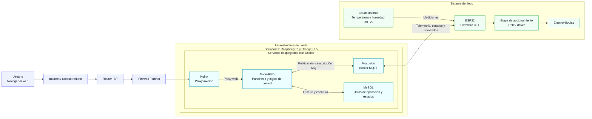

# Sistema IoT de riego inteligente

Sistema de supervisión y control remoto del riego que integra dispositivos ESP32 con una plataforma de servicios desplegada en equipos de borde. La solución permite consultar telemetría, operar electroválvulas desde una interfaz web y ejecutar riegos manuales o temporizados.

## Descripción para CV

Desarrollé un sistema IoT de riego remoto con Node-RED, MQTT y Docker sobre Raspberry Pi y Orange Pi 5. Integré microcontroladores ESP32 programados en C++ para recopilar datos de caudal, temperatura y humedad, y controlar electroválvulas. La solución incluye una interfaz web para supervisión y control manual o temporizado, un broker Mosquitto y persistencia de datos de aplicación y estados en MySQL.

## Objetivo

Desarrollar una solución IoT que reduzca la necesidad de desplazamientos diarios para operar el riego y facilite un uso más eficiente del agua. Para ello, centraliza la comunicación con los dispositivos de campo, la lógica de control, la supervisión web y el almacenamiento de información del sistema.

## Arquitectura

### Flujo de supervisión

Los ESP32 envían por MQTT las mediciones de los caudalímetros y de los sensores DHT22. Node-RED recibe los mensajes, presenta la información en la interfaz web y gestiona la información de aplicación y los estados en MySQL.

### Flujo de control

El usuario acciona las electroválvulas desde el panel web de Node-RED, de forma manual o mediante una duración programada. Node-RED publica los comandos en Mosquitto; los ESP32 suscritos los reciben y activan la etapa de accionamiento correspondiente. Los estados y la telemetría pueden volver al panel mediante MQTT.

## Componentes

| Capa | Componentes | Responsabilidad |
| --- | --- | --- |
| Campo | ESP32 programados en C++, caudalímetros, sensores DHT22 y electroválvulas | Medir variables del sistema y ejecutar órdenes de riego. |
| Mensajería | Mosquitto y MQTT | Transportar telemetría, estados y comandos entre Node-RED y los ESP32. |
| Aplicación | Node-RED y funciones JavaScript | Proporcionar el panel web y coordinar el control manual y temporizado. |
| Datos | MySQL | Persistir información de la aplicación y estados del sistema. |
| Acceso | Nginx, firewall Fortinet y router ISP | Encauzar el acceso web a los servicios de la instalación. |
| Despliegue | Docker sobre Raspberry Pi y Orange Pi 5 | Alojar los servicios de la plataforma en infraestructura de borde. |

## Tecnologías

`ESP32` · `C++` · `Node-RED` · `MQTT` · `Eclipse Mosquitto` · `MySQL` · `Nginx` · `Docker` · `Raspberry Pi` · `Orange Pi 5`

> El esquema refleja los componentes descritos para el proyecto. No se especifican aquí el reparto concreto de contenedores entre placas, la configuración de red, los tópicos MQTT ni las métricas de ahorro de agua.
