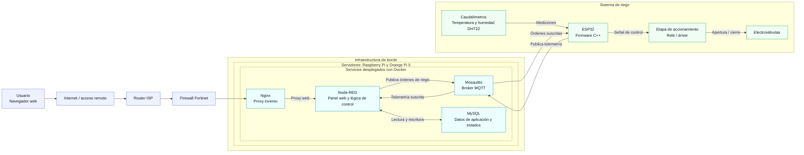
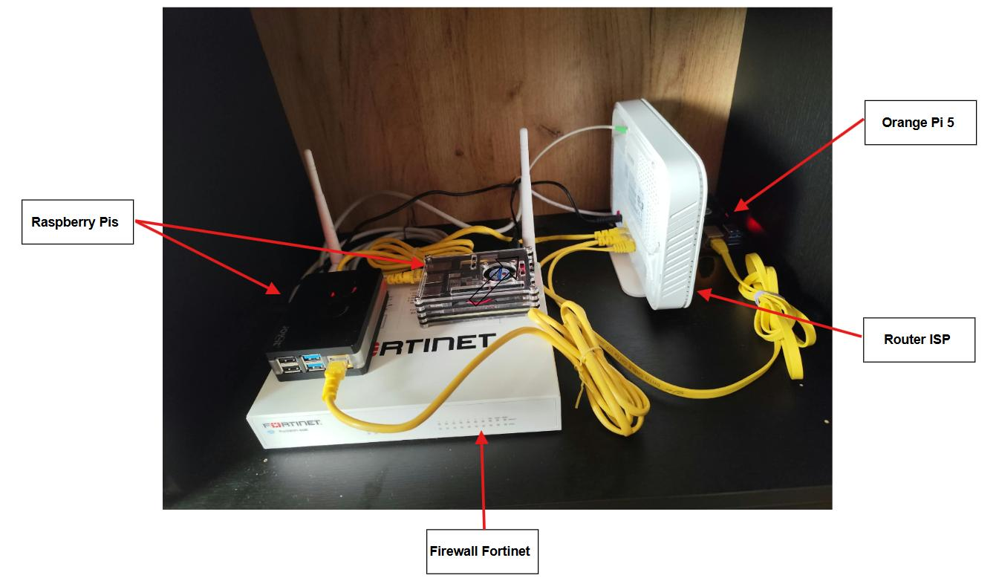
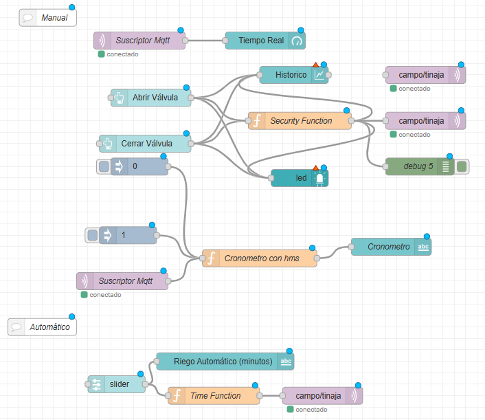
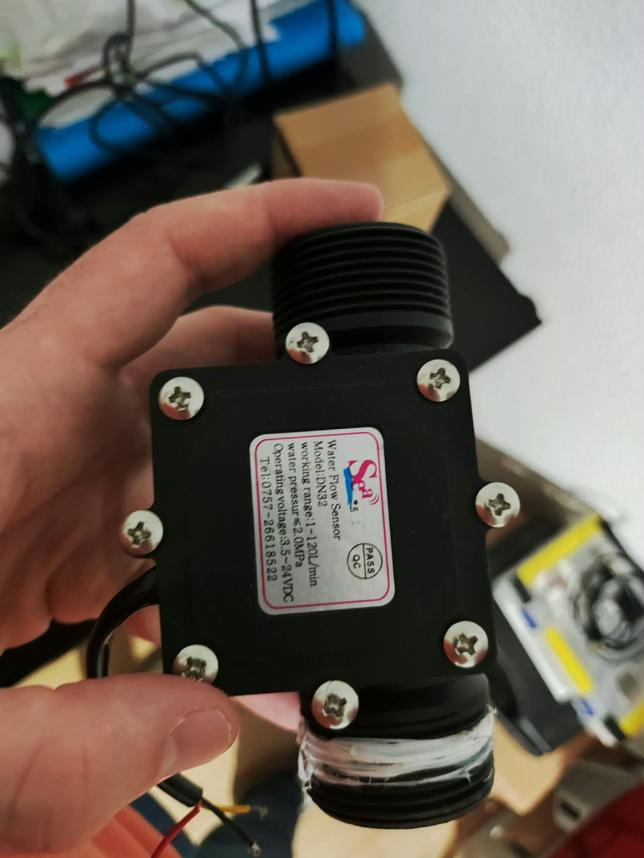
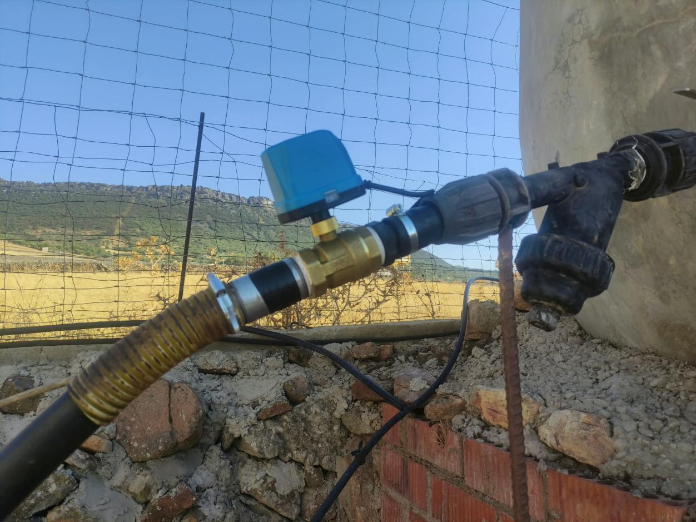
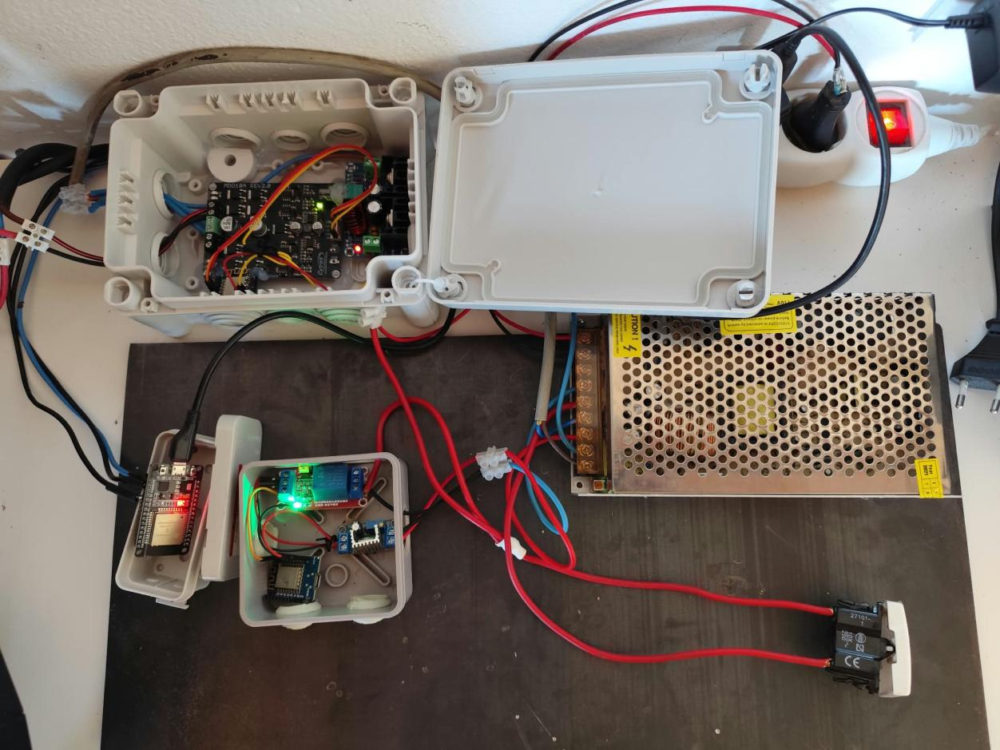

# Sistema IoT de riego inteligente

Sistema de supervisión y control remoto del riego que integra dispositivos ESP32 con una plataforma de servicios desplegada en equipos de borde. La solución permite consultar telemetría, operar electroválvulas desde una interfaz web y ejecutar riegos manuales o temporizados.

## Objetivo

Desarrollar una solución IoT que reduzca la necesidad de desplazamientos diarios para operar el riego y facilite un uso más eficiente del agua. Para ello, centraliza la comunicación con los dispositivos de campo, la lógica de control, la supervisión web y el almacenamiento de información del sistema.

## Arquitectura

### Flujo de supervisión

Los caudalímetros y sensores DHT22 entregan sus mediciones a los ESP32. Cada ESP32 publica la telemetría en Mosquitto mediante MQTT; Node-RED se suscribe a esos mensajes y presenta los datos en la interfaz web. Node-RED también lee y guarda en MySQL la información de aplicación y los estados del sistema.

### Flujo de control

El usuario envía órdenes desde la interfaz web, en modo manual o con una duración programada. Nginx deriva la petición a Node-RED, que publica la orden en Mosquitto. El ESP32 suscrito al mensaje recibe la orden y acciona la electroválvula mediante la etapa de control.

## Componentes

| Capa | Componentes | Responsabilidad |
| --- | --- | --- |
| Campo | ESP32 programados en C++, caudalímetros, sensores DHT22 y electroválvulas | Medir variables del sistema y ejecutar órdenes de riego. |
| Mensajería | Mosquitto y MQTT | Transportar telemetría desde los ESP32 a Node-RED y órdenes de riego en sentido inverso. |
| Aplicación | Node-RED y funciones JavaScript | Proporcionar el panel web y coordinar el control manual y temporizado. |
| Datos | MySQL | Persistir información de la aplicación y estados del sistema. |
| Acceso | Nginx, firewall Fortinet y router ISP | Encauzar el acceso web a los servicios de la instalación. |
| Despliegue | Docker sobre Raspberry Pi y Orange Pi 5 | Alojar los servicios de la plataforma en infraestructura de borde. |

## Tecnologías

`ESP32` · `C++` · `Node-RED` · `MQTT` · `Eclipse Mosquitto` · `MySQL` · `Nginx` · `Docker` · `Raspberry Pi` · `Orange Pi 5`

## Evidencias del proyecto

### Infraestructura de borde

### Flujo de automatización en Node-RED

### Dispositivos de campo

| Caudalímetro | Electroválvula | Controlador y alimentación |
| --- | --- | --- |
|  |  |  |

> El esquema refleja los componentes descritos para el proyecto. No se especifican aquí el reparto concreto de contenedores entre placas, la configuración de red, los tópicos MQTT ni las métricas de ahorro de agua.
